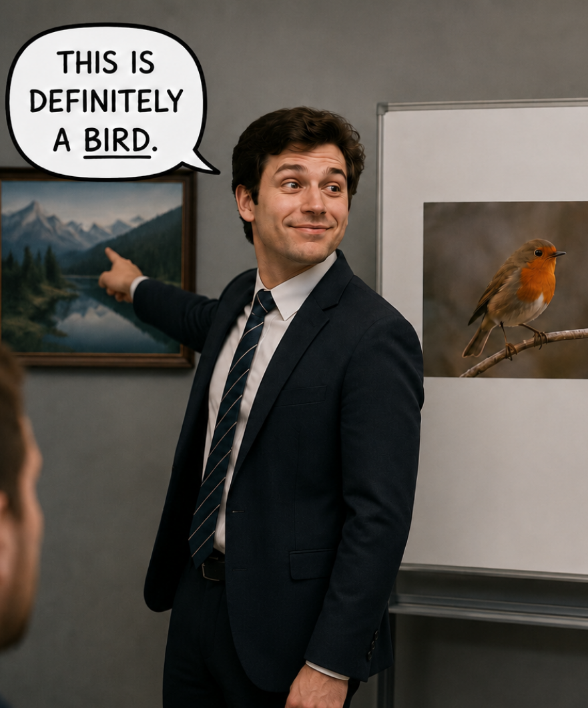
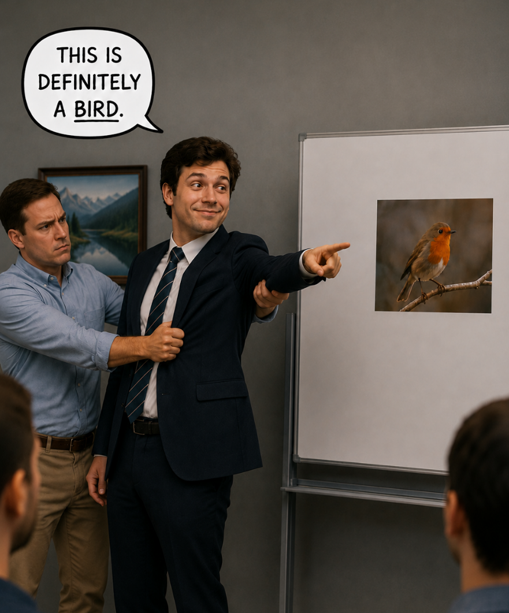
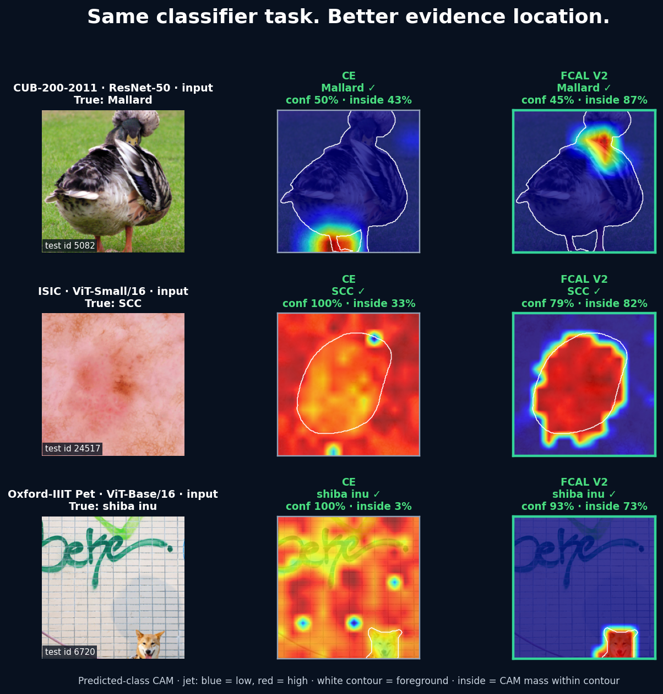
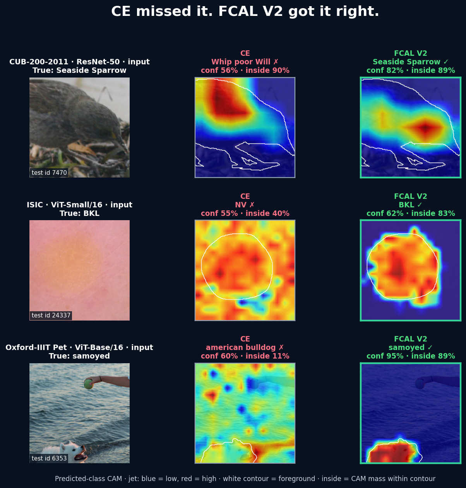
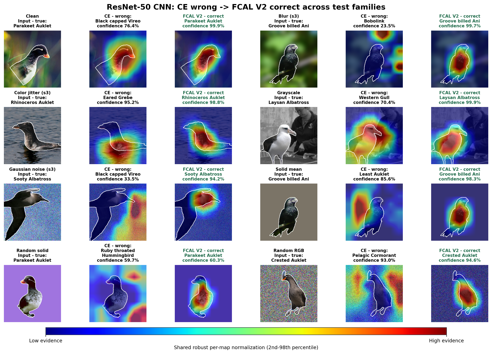
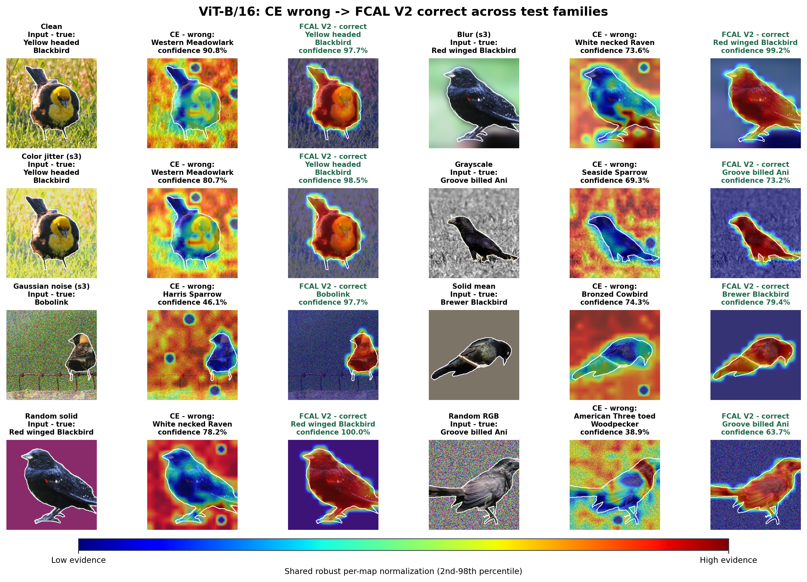

# FCAL — Foreground-Constrained Attention Learning

> Teach image classifiers not only **what** to predict, but **where to look**.

FCAL is a training objective for CNNs and Vision Transformers that moves
class-specific evidence from background shortcuts onto the annotated object.
It changes training only: deployed models keep the same parameters, latency,
and prediction API.

**3 datasets · 6 architectures · 60 matched runs · no inference overhead**

## Improvements at a glance

The strongest complete result is CUB ResNet-50. FCAL V2 improves the clean
prediction and becomes substantially harder to break when only the background
is distorted:

| CUB ResNet-50 test metric | CE | FCAL V2 | Improvement |
|---|---:|---:|---:|
| Clean accuracy | 77.29% | **78.49%** | **+1.20 pp** |
| Mean accuracy across 13 background distortions | 66.92% | **72.11%** | **+5.19 pp** |
| Worst background-distortion accuracy | 28.48% | **48.86%** | **+20.38 pp** |
| Foreground-only accuracy | 68.57% | **72.76%** | **+4.19 pp** |
| Strict attention leakage ↓ | 0.569 | **0.282** | **50.5% lower** |

The broader results retain the background and foreground stress tests rather
than reducing the project to clean accuracy:

| Benchmark | Clean | Background distortions | Foreground evidence | Leakage |
|---|---:|---:|---:|---:|
| CUB ViT-Base/16, V2 vs CE | **+0.93 pp** | mean **+0.75 pp**, worst **+2.07 pp** | foreground-only **+1.21 pp** | **76.7% lower** |
| Oxford Pet, six-model V2 mean vs CE | **+0.50 pp** | mean **+0.67 pp** | mean FG distortions **+0.61 pp**, foreground-only **+2.35 pp** | **34.6% lower** |
| Oxford Pet, six-model Universal mean vs CE | **+0.42 pp** | mean **+0.62 pp** | mean FG distortions **+0.74 pp**, foreground-only **+2.18 pp** | approximately flat |

These are single-seed results. Architecture-level gains and six-model means are
identified explicitly rather than mixed into one headline number.

## The problem in two pictures

<table>
  <tr>
    <td width="50%"></td>
    <td width="50%"></td>
  </tr>
  <tr>
    <td align="center"><strong>Cross-entropy:</strong> a correct label can still come from the wrong evidence.</td>
    <td align="center"><strong>FCAL:</strong> the mask teaches the model where class evidence should live.</td>
  </tr>
</table>

A standard classifier is rewarded for the right answer, even if it uses grass,
clinic artifacts, or scene context. FCAL adds spatial supervision to the normal
classification loss during training. At inference, the mask and auxiliary loss
disappear.

## What FCAL changes visually



Green means the class is correct. The white contour is the annotated
foreground. `inside` is the positive predicted-class CAM mass inside it. All
CAMs use `jet`: blue is low evidence and red is high evidence.

## When better focus changes the answer

These held-out examples are classification rescues: CE predicts the wrong
class, while FCAL V2 predicts the correct one from evidence concentrated on the
foreground.



These examples explain the mechanism; the aggregate claims above come from
every test image, not from the selected gallery.

## Background-distortion stress tests

Here the bird pixels are preserved exactly while only the background is
changed. The suite includes blur, color jitter, Gaussian noise, grayscale,
solid-mean replacement, random-solid color, and random RGB noise. Each row is a
held-out rescue where the distorted background makes CE predict the wrong bird
but FCAL V2 remains correct.

### ResNet-50 CNN



### ViT-Base/16



These montages are selected qualitative rescues. The **+5.19 pp mean** and
**+20.38 pp worst-case** ResNet-50 improvements reported above are calculated
over all 5,794 test images and all 13 background variants.

## Results that matter

| Dataset | Main result | What to conclude |
|---|---|---|
| [CUB-200-2011](results/cub/README.md) | ResNet-50 V2: **+1.20 pp clean**, **+5.19 pp mean background**, **+20.38 pp worst background**, **+4.19 pp foreground-only**, **50.5% lower leakage** | Strongest end-to-end accuracy and robustness result |
| [Oxford-IIIT Pet](results/oxford_pet/README.md) | Six-model V2 mean: **+0.50 pp clean**, **+0.67 pp mean background**, **+0.61 pp mean foreground distortions**, leakage **0.292 → 0.191** | Broadest and most consistent benchmark |
| [ISIC](results/isic/README.md) | Six-model V2 mean leakage **0.441 → 0.257**, but clean accuracy **66.50% → 64.83%** | Stronger focus does not automatically mean higher accuracy |
| [Universal FCAL](results/universal/README.md) | Pet mean clean **+0.42 pp** and best mean foreground-corruption score; ISIC pilot is mixed | Working architecture-independent controller, still experimental |

The qualitative galleries are backed by frozen manifests and real checkpoint
inference. Each dataset page shows one test image per model; the executed
notebooks show three per model:

- [Bird test notebook](notebooks/cub_test_showcase.ipynb)
- [Skin-lesion test notebook](notebooks/isic_test_showcase.ipynb)
- [Pet test notebook](notebooks/oxford_pet_test_showcase.ipynb)

## Three versions, one research direction

| Method | Idea | Current role |
|---|---|---|
| **FCAL V1** | Penalize normalized positive class evidence outside a tolerance-expanded foreground | Original, simple containment baseline |
| **FCAL V2** | Add scale-normalized, distributed foreground support and resolution-aware tolerance | Main supported method; called V5 during internal ablations |
| **Universal FCAL** | Calibrate targets automatically, budget auxiliary gradients, project conflicts, and schedule the objective from validation behavior | Architecture-independent research implementation |

CNN galleries use exact final-feature class activation maps. The ViTs use
average-pooled patch tokens, so their class-specific patch CAMs decompose the
actual class score instead of substituting a generic attention visualization.

## Why the comparison is fair

- Each FCAL run resumes from its paired CE model's exact epoch-5 checkpoint.
- Architecture-specific data, initialization, optimizer, schedule, and
  50-epoch budget remain matched.
- Test examples, foreground masks, and deterministic corruptions are identical
  across methods.
- Classification and localization are reported separately; failures are not
  hidden behind a single score.
- Full tables and machine-readable CSVs are committed under [`results/`](results/).

The study spans ResNet-50, DenseNet-121, EfficientNet-B0, ViT-Tiny/16,
ViT-Small/16, and ViT-Base/16 on birds, skin lesions, and pet breeds.

## Repository map

```text
FCAL/
├── assets/                  README figures and frozen CAM galleries
├── configs/                 matched CUB, ISIC, and Oxford Pet experiments
├── docs/                    methods and reproduction notes
├── notebooks/               executed visual test audits
├── results/                 dataset landing pages, full tables, and CSVs
├── splits/                  frozen train/validation/test manifests
├── src/
│   ├── fcal_study/          data, CAM adapters, training, and evaluation
│   └── universal_fcal/      standalone architecture-independent objective
└── tests/
```

Datasets live in the workspace-level [`../datasets/`](../datasets/) folder.
Checkpoints, caches, and full prediction arrays are intentionally excluded from
Git.

## Quick start

Python 3.10+ and a CUDA-capable PyTorch installation are recommended.

```bash
python -m venv .venv
# Windows: .venv\Scripts\activate
# Linux/macOS: source .venv/bin/activate
pip install -e ".[dev]"
python -m pytest
```

The reported environment is pinned in [`requirements-lock.txt`](requirements-lock.txt).
Install the PyTorch build matching your CUDA runtime before the remaining
packages when necessary.

### Train a matched CUB ResNet-50 comparison

```bash
python -m fcal_study.train configs/cub/resnet50_ce.yaml
python -m fcal_study.train configs/cub/resnet50_fcal.yaml \
  --resume outputs/resnet50-ce-seed42/epoch-005-branch.pt
python -m fcal_study.train configs/cub/resnet50_fcal_v2.yaml \
  --resume outputs/resnet50-ce-seed42/epoch-005-branch.pt
```

Evaluate the selected checkpoint:

```bash
python -m fcal_study.evaluate outputs/resnet50-fcal-v2-seed42/best-validation.pt
```

Dataset setup, the experiment configs, and the fairness protocol are in
[Reproducing the study](docs/REPRODUCIBILITY.md). The objective equations and
design decisions are in [Methods](docs/METHODS.md).

## Universal FCAL as a library

```python
from universal_fcal import UniversalFCAL, budgeted_objective

objective = UniversalFCAL(
    allowed_outside=0.20,
    target_coverage=0.30,
    tolerance_cell_fraction=0.5,
)

result = objective(model.raw_class_evidence(labels), masks, logits, labels)
total, weighted_fcal, weight = budgeted_objective(
    ce_loss,
    result.auxiliary,
    phase=1.0,
    target_loss_ratio=0.05,
    lambda_max=1000.0,
)
```

The model adapter only needs to return one or more signed evidence maps shaped
`[batch, height, width]`.

## Limits and research status

- Every completed benchmark currently uses one training seed. Image-level
  paired tests do not replace multi-seed training uncertainty.
- The ISIC sealed test has 100 images and very small rare classes. These results
  do not establish clinical effectiveness.
- Better CAM localization does not guarantee better classification; ISIC and
  the smaller ViTs make that boundary explicit.
- Universal FCAL is functional and fully benchmarked on Oxford-IIIT Pet, but
  its automatic controller remains experimental.

The support-aware objective was called **V5** while intermediate ablations were
still active. It is the second supported public method, so this repository calls
it **FCAL V2** everywhere users encounter it.
