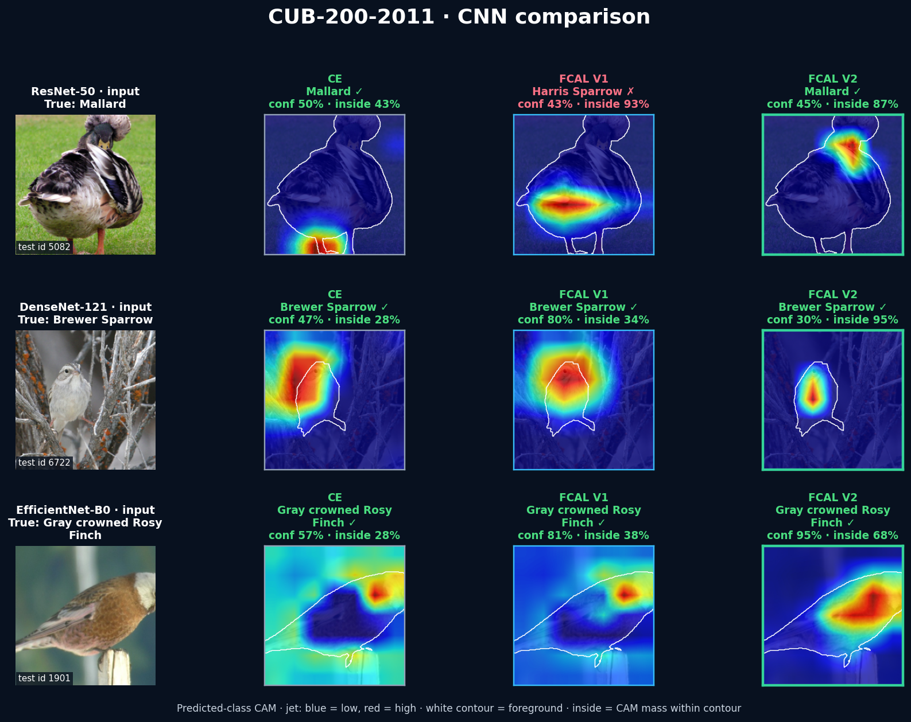
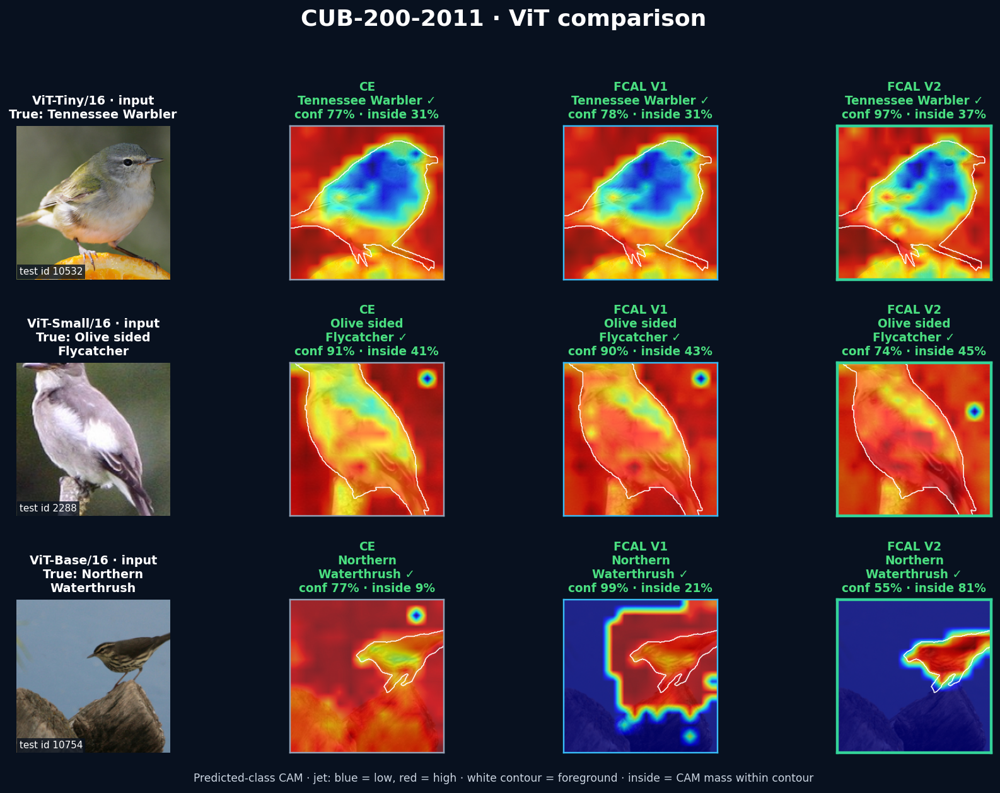
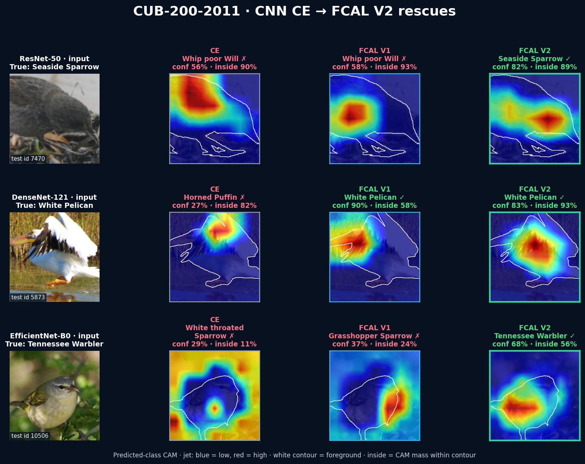

# CUB-200-2011: where bird classifiers look

FCAL V2's strongest result is the matched ResNet-50 comparison: it improves
clean accuracy and every background-focused robustness measure while sharply
reducing class-evidence leakage. The completed foreground tests also expose an
important trade-off: average foreground-corruption accuracy is slightly lower.

## ResNet-50, one matched training seed

| Test metric | CE | FCAL V1 | FCAL V2 | V2 vs CE |
|---|---:|---:|---:|---:|
| Clean accuracy | 77.29% | 77.36% | **78.49%** | **+1.21 pp** |
| BG mean (13 tests) | 66.92% | 69.61% | **72.11%** | **+5.19 pp** |
| BG worst (13 tests) | 28.48% | 41.44% | **48.86%** | **+20.38 pp** |
| FG mean (13 tests) | **33.00%** | 31.92% | 31.87% | -1.14 pp |
| FG worst (13 tests) | **2.47%** | 1.83% | 1.59% | -0.88 pp |
| Foreground only | 68.57% | 70.73% | **72.76%** | **+4.19 pp** |
| Background only | 4.85% | 4.45% | **3.88%** | **-0.97 pp** |
| Strict leakage (lower is better) | 0.569 | 0.567 | **0.282** | **50.5% lower** |

`BG mean/worst` and `FG mean/worst` always use the same 13 common regional
corruptions. The foreground or background not under test is copied exactly.
Lower background-only accuracy is consistent with less recoverable class signal
after the bird is removed, but it is not a standalone proof of causality.

## ResNet-50 replication across three training seeds

| Method | Clean | BG mean | BG worst | Foreground only | Leakage |
|---|---:|---:|---:|---:|---:|
| CE | 77.44 ± 0.13% | 68.75 ± 1.70% | 38.90 ± 9.81% | 68.63 ± 0.34% | 0.571 ± 0.003 |
| FCAL V1 | 77.61 ± 0.34% | 70.00 ± 0.39% | 43.86 ± 2.46% | 70.57 ± 0.39% | 0.568 ± 0.001 |
| FCAL V2 | **78.49 ± 0.16%** | **72.40 ± 0.38%** | **51.67 ± 4.00%** | **72.51 ± 0.87%** | **0.281 ± 0.003** |

Values are mean ± sample SD for training seeds 7, 42, and 123 on the same
fixed split. The paired-seed V2-minus-CE deltas are **+1.05 ± 0.19 pp clean**,
**+3.65 ± 1.37 pp BG mean**, **+12.77 ± 6.63 pp BG worst**, and
**+3.87 ± 0.57 pp foreground-only**. All three paired seeds favor V2 on these
metrics. Three seeds are much stronger than one, but still a small uncertainty
sample.

## Bird-specific scenarios

| ResNet-50 scenario | CE | FCAL V1 | FCAL V2 | V2 vs CE |
|---|---:|---:|---:|---:|
| Twilight habitat (realistic simulation) | 75.30% | 75.60% | **76.56%** | **+1.26 pp** |
| Camouflage background (extreme) | 67.38% | 69.73% | **71.88%** | **+4.50 pp** |

Both scenarios modify only the annotated background. Twilight introduces a
dawn/dusk illumination and color shift. Camouflage deliberately matches the
background color to the bird and adds smooth texture. These are controlled,
deterministic simulations—not natural-distribution performance estimates.

## What changes visually

Every panel below uses the same held-out image across methods. Green/red text
marks a correct/incorrect prediction, the white contour is the bird mask, and
`inside` is the positive predicted-class CAM mass within that contour. All CAMs
use `jet`: blue is low evidence and red is high evidence.

### CNN examples

### Vision Transformer examples

## CE wrong, FCAL V2 correct

These are selected held-out rescues, not a random sample. The tables above use
all 5,794 test images.

## Background distortions

Bird pixels remain bit-identical while only the background is blurred,
recolored, made grayscale, noised, or replaced.

## Scope and files

The six-architecture method means are: clean 79.48% to 80.05%, BG mean 72.54%
to 73.75%, BG worst 50.40% to 55.05%, and leakage 0.685 to 0.473 for CE to V2.
FG mean moves from 37.42% to 37.06%, so the robustness improvement is specific
to background interventions rather than universal corruption robustness.

- [Executed test notebook](../../notebooks/cub_test_showcase.ipynb)
- [Complete per-model metrics](complete_metrics.csv)
- [Unified six-model means](method_means_complete.csv)
- [Tailored scenario results](tailored_scenarios.csv)
- [Three-seed metrics](resnet50_three_seed_metrics.csv)
- [Three-seed mean and SD](resnet50_three_seed_summary.csv)
- [V2 component ablation](v2_component_ablation.csv)
- [Stress-test definitions](../../docs/STRESS_TESTS.md)
- [Detailed interpretation and limitations](RESULTS.md)

The main six-architecture matrix still uses one training seed. The ResNet-50
replication is reported separately so broader architecture coverage is not
confused with training-run uncertainty.
