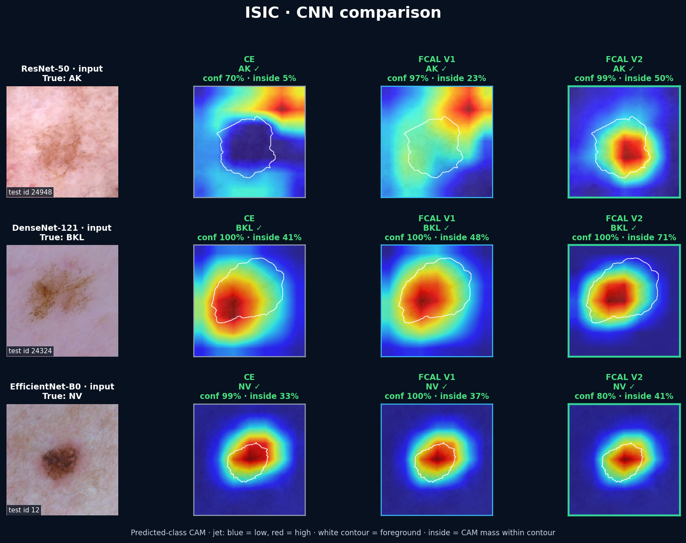
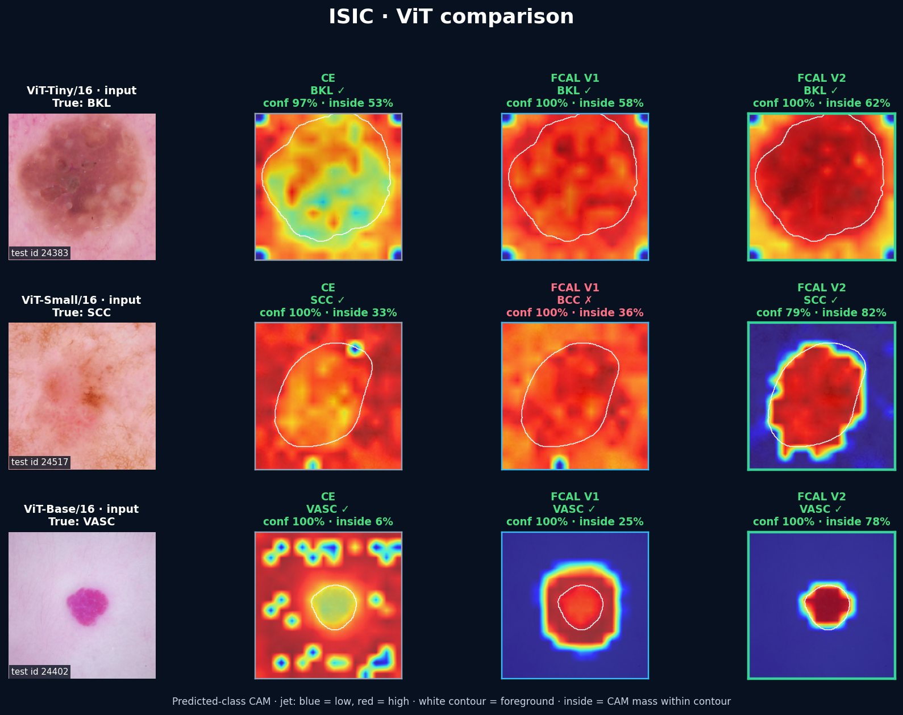
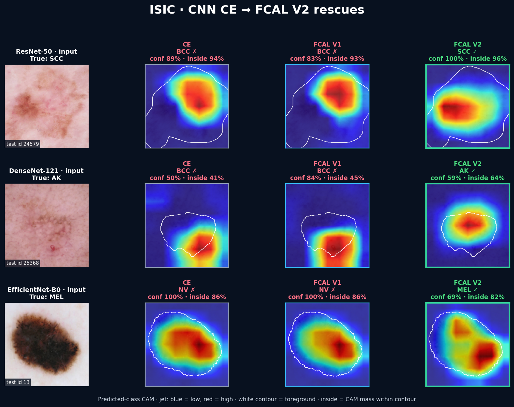
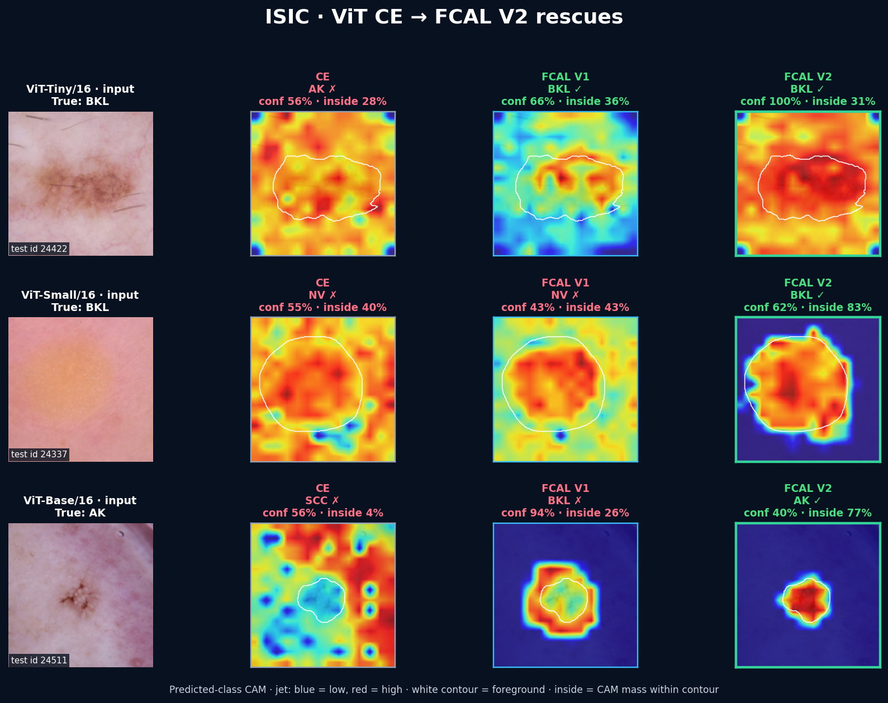

# ISIC subset: focus improves, classification does not

This curated 100-image test set is the clearest counterexample to an overbroad
FCAL claim. Across six architectures, V2 strongly reduces outside-lesion CAM
leakage and improves foreground-only accuracy, but it lowers clean accuracy and
does not improve the tailored background-artifact simulations.

## Unified six-architecture means

| Test metric | CE | FCAL V1 | FCAL V2 | V2 vs CE |
|---|---:|---:|---:|---:|
| Clean accuracy | **66.50%** | 64.67% | 64.83% | -1.67 pp |
| Balanced accuracy | **69.52%** | 67.97% | 67.66% | -1.86 pp |
| BG mean (13 tests) | 49.65% | 48.86% | **49.82%** | +0.17 pp |
| BG worst (13 tests) | **34.83%** | 32.33% | 33.83% | -1.00 pp |
| FG mean (13 tests) | **37.00%** | 35.60% | 35.76% | -1.24 pp |
| FG worst (13 tests) | **15.83%** | 13.00% | 15.33% | -0.50 pp |
| Foreground only | 42.50% | 42.83% | **46.17%** | **+3.67 pp** |
| Background only | 23.33% | **21.50%** | 21.67% | -1.67 pp |
| Strict leakage (lower is better) | 0.441 | 0.385 | **0.257** | **41.6% lower** |

One prediction changes clean accuracy by one percentage point, and the rarest
class has only three test images. These numbers describe model behavior on this
subset; they are not evidence of clinical effectiveness.

## Skin-imaging scenarios

| Six-model mean | CE | FCAL V1 | FCAL V2 | V2 vs CE |
|---|---:|---:|---:|---:|
| Hair outside lesion | **56.83%** | 57.83% | 56.33% | -0.50 pp |
| Ruler outside lesion | **63.17%** | 63.00% | 62.17% | -1.00 pp |
| Low-contrast lesion | 35.00% | 34.83% | **36.67%** | +1.67 pp |

The first two simulations change only surrounding skin; the lesion is copied
exactly. The low-contrast test changes only the lesion and preserves every
background pixel. Hair is a plausible acquisition artifact, while the ruler
and strong contrast reduction are deliberately severe. The mixed result is
reported as a failure to demonstrate background-artifact robustness here.

## Prediction and CAM examples

Green/red titles mark correct/incorrect predictions. The white contour is the
lesion mask and `inside` is positive predicted-class CAM mass inside it. Every
CNN and ViT panel uses `jet` (blue low, red high).

### CNN examples

### Vision Transformer examples

## CE wrong, FCAL V2 correct

These are selected qualitative rescues, not a prevalence estimate.

## Files

- [Executed test notebook](../../notebooks/isic_test_showcase.ipynb)
- [Complete per-model metrics](complete_metrics.csv)
- [Unified six-model means](method_means_complete.csv)
- [Tailored scenario results](tailored_scenarios.csv)
- [Stress-test definitions](../../docs/STRESS_TESTS.md)
- [Full results and limitations](RESULTS.md)
- [Universal FCAL ResNet-50 pilot](../universal/isic/RESULTS.md)

All runs use one training seed and a leakage-free, lesion-grouped split. Masks
mix expert challenge boundaries with reviewed novice U-Net boundaries, which
adds another source of uncertainty.
