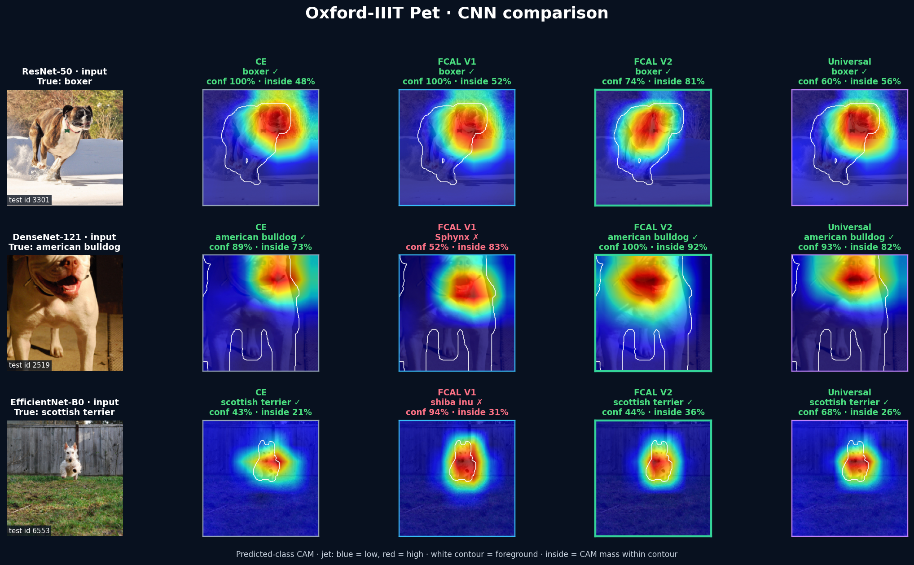
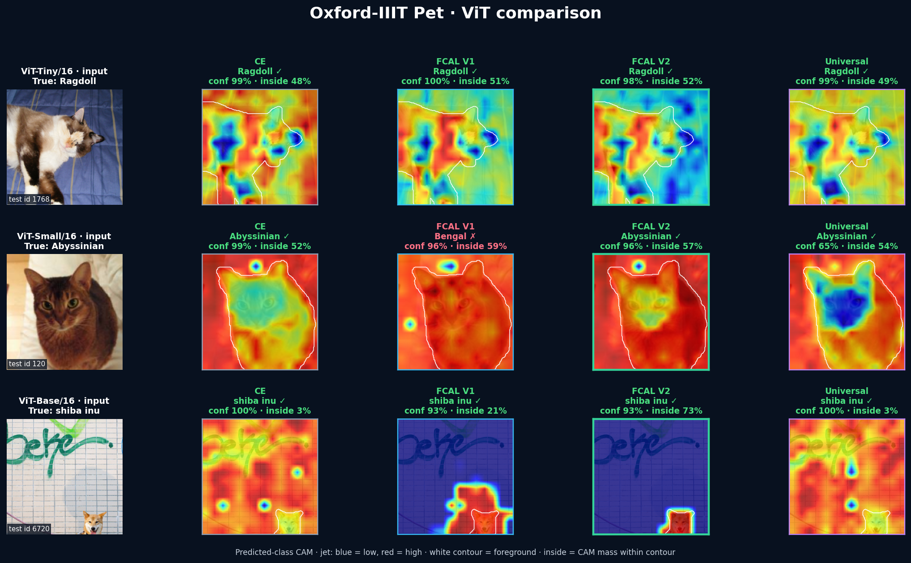
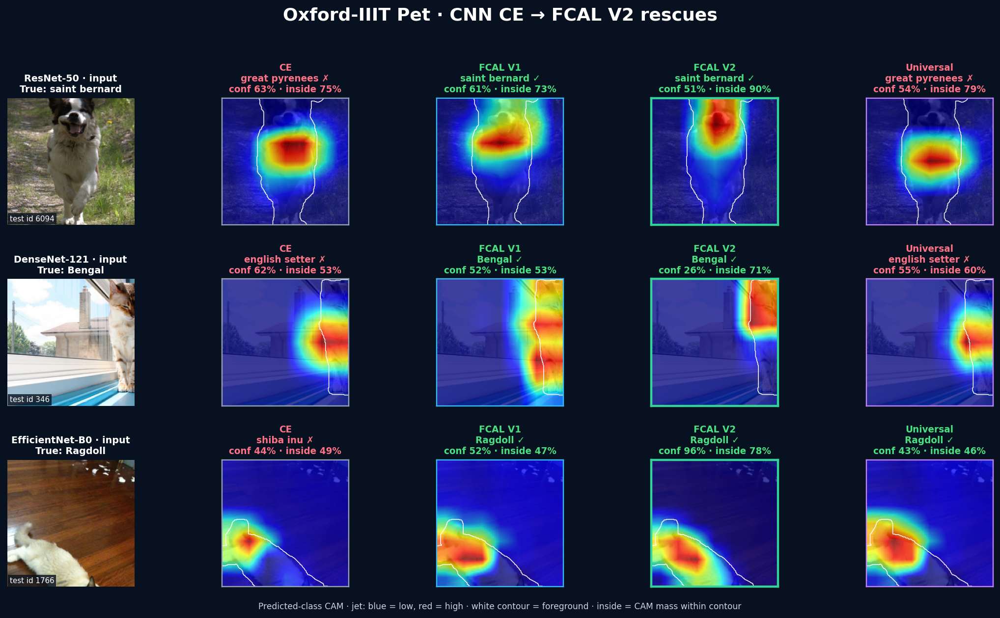
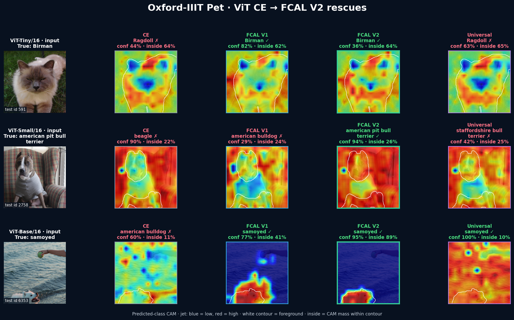

# Oxford-IIIT Pet: the broadest FCAL benchmark

Oxford Pet has 3,669 held-out test images and official pixel-level trimaps.
Across six architectures, FCAL V2 improves clean accuracy, both average and
worst background robustness, foreground-only accuracy, and strict localization.

## Unified six-architecture means

| Test metric | CE | FCAL V1 | FCAL V2 | V2 vs CE |
|---|---:|---:|---:|---:|
| Clean accuracy | 89.52% | 89.79% | **90.03%** | **+0.50 pp** |
| BG mean (13 tests) | 86.81% | 86.50% | **87.48%** | **+0.67 pp** |
| BG worst (13 tests) | 74.99% | 74.61% | **76.29%** | **+1.30 pp** |
| FG mean (13 tests) | 46.85% | 47.08% | **47.46%** | **+0.61 pp** |
| FG worst (13 tests) | **3.26%** | 3.17% | 2.97% | -0.29 pp |
| Foreground only | 86.59% | 84.51% | **88.94%** | **+2.36 pp** |
| Background only | 4.03% | 4.04% | **3.54%** | **-0.49 pp** |
| Strict leakage (lower is better) | 0.292 | 0.261 | **0.191** | **34.6% lower** |

The complete protocol uses the same 13 common interventions per region. V2's
very low FG-worst score is a useful boundary condition: better focus does not
make a classifier robust when the discriminative animal pixels themselves are
almost destroyed.

## Pet-specific scenarios

| Six-model mean | CE | FCAL V1 | FCAL V2 | V2 vs CE |
|---|---:|---:|---:|---:|
| Warm indoor-light background | 89.19% | 89.35% | **89.80%** | **+0.61 pp** |
| Saturated checkerboard background | 87.23% | 87.51% | **87.73%** | **+0.50 pp** |

Warm light is a realistic household-lighting simulation; the checkerboard is
an intentionally extreme high-frequency distractor. Pet pixels remain exact in
both. These controlled tests complement—not replace—natural-shift evaluation.

## Prediction and CAM examples

Green/red titles mark correct/incorrect breed predictions. The white contour
is the official pet trimap and `inside` is positive predicted-class CAM mass
inside it. Every CNN and ViT panel uses `jet` (blue low, red high).

### CNN examples

### Vision Transformer examples

## CE wrong, FCAL V2 correct

These selected held-out rescues illustrate the mechanism; the results above
use all test images.

## Files and statistical scope

- [Executed test notebook](../../notebooks/oxford_pet_test_showcase.ipynb)
- [Complete per-model metrics](complete_metrics.csv)
- [Unified six-model means](method_means_complete.csv)
- [Tailored scenario results](tailored_scenarios.csv)
- [Stress-test definitions](../../docs/STRESS_TESTS.md)
- [Full results and paired clean tests](RESULTS.md)

Exact paired McNemar tests quantify disagreement for each trained CE/V2 pair;
they do not estimate training-seed uncertainty. This matrix uses one seed, so
the modest six-model accuracy deltas should be read as descriptive evidence.
Universal FCAL results remain separate because they answer a different
controller-design question and are not available as the same three-method
matrix on every dataset.
